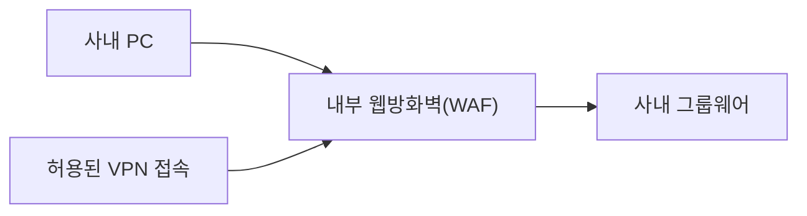
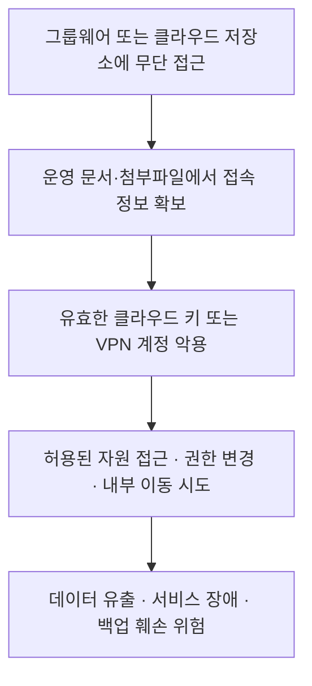

그룹웨어가 해킹당했다는 소식을 들으면 우리는 무엇부터 걱정할까?

직원의 이름과 연락처, 전자결재 문서, 업무 파일의 유출을 먼저 떠올릴 것이다. 물론 모두 중요하다.

하지만 그 안에 **다른 시스템의 ID와 비밀번호**가 있었다면 문제는 달라진다.

> "클라우드 관리자 계정은 운영 문서에 있습니다."  
> "VPN 비밀번호와 서버 접속 정보는 첨부파일을 확인해 주세요."

*이 대화는 위험을 설명하기 위한 가상 예시이며, 아래에 언급하는 실제 사고에서 확인된 대화가 아니다.*

공격자에게 이런 정보는 단순한 업무자료가 아니다. **다른 시스템에 접근할 수 있는 자격증명**이다. 그룹웨어 해킹 대응에서 이 정보를 따로 점검해야 하는 이유다.

MITRE ATT&CK도 채팅에서 비밀번호·API 키·인증 토큰을 수집하는 행위를 **T1552.008, Chat Messages**로 분류한다.[^1]

> **그룹웨어 어딘가에 기록된 비밀번호는 공격자가 노리는 중요한 대상이다.**  
> **그 접속 정보가 여전히 유효하다면, 피해는 그룹웨어 밖으로 이어질 수 있다.**

---

## 먼저 결론부터: 그룹웨어의 복구만으로 대응을 끝내서는 안 된다

여기서 말하는 비밀번호는 **그룹웨어 로그인 데이터베이스에 저장된 비밀번호만을 뜻하지 않는다.** 직원이 채팅·문서·첨부파일에 남긴 **다른 서비스와 내부 시스템의 비밀번호**가 핵심이다.

확인해야 할 것은 세 가지다.

- **무엇이 있었는가?** 다른 시스템의 계정·비밀번호·키·토큰이 기록돼 있었는가?
- **지금도 유효한가?** 노출이 의심되는 자격증명에 접근권한이 남아 있는가?
- **실제로 사용됐는가?** 해당 계정이나 키로 인증·권한 변경·자료 접근이 발생했는가?

자격증명 유출 대응은 침해된 서비스 안에서 끝나지 않는다. **노출된 권한으로 접근할 수 있는 다른 시스템까지 확인해야 한다.**

---

## 1. 최근 공지에서 확인된 사실부터 구분하자

취약점 공지, 침해사고 공지, 예방적 보안 강화는 구분해야 한다. 각 회사의 공식 자료가 설명하는 범위도 다르다.

| No. | 대상 | 공식 자료에서 확인한 내용 | 단정할 수 없는 내용 |
| ---: | --- | --- | --- |
| 1 | **다우오피스** | 일부 버전의 접근통제 미흡 취약점과 보안 패치 안내[^2] | 모든 고객사 침해·다른 시스템 비밀번호 유출 |
| 2 | **더존비즈온** | 개발 서버 침해사고와 APO 백업 서버 침해 정황 공개[^3][^4] | 모든 사안을 그룹웨어 침해로 분류·고객 자격증명 유출 확정 |

다우오피스의 **2026년 11월 2일 공지**상 영향 버전은 **3.6.8.5 이하**다. 서비스형·엔터프라이즈형·HR형은 **해당 취약점**의 영향 대상이 아니다.[^2]

더존비즈온은 **10월 26일** 개발 서버의 외부 불법 접근과 APO 백업 서버 관련 침해 정황을 발표했다. 앞선 **10월 23일 백업서비스 공지**에서는 실제 유출 대상과 항목을 조사 중이라고 밝혔다.[^3][^4]

두 공지는 서로 다른 사안을 다룬다. **이 글은 다른 시스템의 자격증명이 실제로 유출됐다고 단정하지 않는다.** 기업이 점검해야 할 연쇄 침해 위험을 설명한다.

---

## 2. 그룹웨어뿐 아니라 범용 클라우드도 함께 봐야 한다

이 문제는 그룹웨어에만 국한되지 않는다. **비밀번호가 포함된 운영 문서가 어디에 저장돼 있었는지**를 함께 확인해야 한다. MITRE는 채팅뿐 아니라 파일과 공유 저장소에 부적절하게 보관된 자격증명을 찾는 공격도 분류한다.[^1][^5]

### 퍼블릭 클라우드형 그룹웨어와 SaaS 협업 서비스의 예

그룹웨어뿐 아니라 프로젝트·업무·메신저 중심 협업 도구도 같은 관점에서 살펴봐야 한다. 아래는 **사업자가 운영하는 클라우드 서비스를 온라인으로 이용하는 형태**의 예시다.

| No. | 서비스 | 클라우드형 제공·주요 기능 |
| ---: | --- | --- |
| 1 | **다우오피스** | 공용 클라우드 환경에서 이용하는 공유형 그룹웨어[^6] |
| 2 | **플로우(Flow)** | 프로젝트·업무·메신저 중심의 협업 서비스[^7] |
| 3 | **하이웍스** | 메일·전자결재·메신저·문서 공유를 제공하는 그룹웨어[^8] |
| 4 | **네이버웍스** | 메시지·메일·캘린더 등 업무 협업 기능과 드라이브를 제공하는 서비스[^9] |
| 5 | **두레이(Dooray!)** | 프로젝트·메일·메신저·드라이브·결재를 제공하는 협업 서비스[^10] |

*클라우드형 제공을 기준으로 든 예시다. 구축형·전용형 등 다른 상품까지 운영 구조나 기능이 같다는 뜻은 아니며, 위 목록은 침해사고 사례나 보안 수준 평가가 아니다.*

이들 서비스에서 확인할 것은 제품명이 아니라 **어떤 업무자료를 보관하고, 누가 접근하며, 그 안에 다른 시스템의 접속 정보가 남아 있는가**다.

### 저장·공유 공간과 실제 접근 대상까지 함께 점검한다

범용 클라우드는 **접속 정보를 보관하는 저장·공유 공간**과 **그 정보로 접근하는 인프라 환경**으로 나눠 살펴보자.

| No. | 점검 영역 | 대상 예시 | 확인할 위험 |
| ---: | --- | --- | --- |
| 1 | **그룹웨어·협업 공간** | 채팅·게시글·전자결재·인수인계 문서·첨부파일 | 기록된 비밀번호·키·토큰의 악용 |
| 2 | **범용 클라우드 저장·공유** | Google Drive, Microsoft OneDrive·SharePoint, Dropbox | 문서 무단 열람·다운로드·공유 확대 |
| 3 | **범용 인프라 클라우드** | AWS, Microsoft Azure, Google Cloud, NAVER Cloud, Oracle Cloud Infrastructure | 계정·API 권한을 통한 자원 접근·변경 |
| 4 | **내부 온프레미스** | VPN·서버·데이터베이스·백업·관리자 시스템 | 유효한 계정과 접근 경로를 이용한 침입 |

*서비스명은 점검 범위를 설명하기 위한 예시다. 해당 사업자에 침해사고가 발생했다는 의미가 아니다.*

**클라우드 사업자의 침해**와 **우리 회사 계정·공유 설정의 악용**은 다른 문제다. 사업자 전체가 침해되지 않아도 유출된 사용자 자격증명이 악용될 수 있다.[^11]

따라서 "우리는 그룹웨어가 아니라 클라우드 드라이브에 보관했으니 괜찮다"는 결론도 위험하다. 중요한 것은 제품명이 아니라 **자료의 내용, 접근권한, 실제 접근 흔적**이다.

### 사내 그룹웨어도 웹방화벽으로 보호해야 한다

“외부에 공개하지 않고 사내에서만 쓰니 안전하다”는 결론도 위험하다. 직원 PC가 감염되거나 탈취된 VPN 계정으로 내부 접근이 가능해지면, 공격 요청은 사내에서 시작될 수 있다. **내부망이라는 위치만으로 요청을 신뢰해서는 안 된다.**[^11][^27]

따라서 **웹 기반 사내 그룹웨어에도 웹방화벽(WAF)을 적용해야 한다.** 접속을 허용했다는 것과, 그 접속으로 전달되는 웹 요청이 안전하다는 것은 다르다. WAF는 SQL 인젝션·XSS 등의 웹 공격을 정책에 따라 탐지·차단하는 방어 계층이다.[^28]

인터넷에 서비스를 공개할 필요 없이, 다음과 같이 내부에 구성할 수 있다.[^29]

**외부 접속뿐 아니라 내부 사용자·VPN의 웹 요청도 WAF를 거치게 하고, 원본 서버로의 직접 우회 접속을 막아야 한다.** HTTPS는 WAF에서 요청 내용을 검사할 수 있도록 TLS를 처리하고, 서버 구간도 암호화하도록 설계한다.[^28][^30]

다만 **유효한 계정의 권한 악용까지 WAF 하나로 모두 막을 수는 없다.** 취약점 패치·MFA·문서별 권한 통제·계정 및 서버 행위 분석을 함께 운영해야 한다.[^11][^12][^28]

> **내부에 있다는 것은 위치 설명이지, 웹 공격 방어를 생략할 이유가 아니다.**

---

## 3. 비밀번호 유출 이후의 공격은 하나가 아니다

그룹웨어나 공유 문서에서 자격증명이 노출됐다고 가정하면, 다음과 같은 공격 경로를 구분해야 한다.

| No. | 공격 경로 | 의미 |
| ---: | --- | --- |
| 1 | **유효한 계정으로 직접 접근** | 확보한 VPN·관리자 계정 등을 원래 사용하던 시스템에 이용한다.[^11] |
| 2 | **크리덴셜 스터핑** | 이미 유출된 ID·비밀번호 조합을 다른 서비스에도 대입해 비밀번호 재사용을 악용한다.[^12] |
| 3 | **API 키·서비스 계정 악용** | 사람의 로그인 화면 대신 프로그램용 자격증명으로 API에 접근한다.[^13] |
| 4 | **내부 시스템으로 이동** | VPN·원격접속 등 도달 가능한 경로와 확보한 권한을 이용해 다른 시스템을 노린다.[^11] |

**모든 자격증명 악용이 크리덴셜 스터핑은 아니다.** 특정 서버에 유출된 비밀번호로 로그인하는 것과, 같은 조합을 여러 서비스에 대입하는 것은 다른 공격이다.

다음은 특정 사고의 재구성이 아닌 **가상의 확산 시나리오**다.

ID나 접속 주소만으로 침입이 자동으로 성공하는 것은 아니다. **자격증명의 유효성, 부여된 권한, 추가 인증, 네트워크 접근 통제**가 실제 피해 범위를 결정한다.[^11][^12][^14]

---

## 4. 2차 인증만으로 노출된 권한이 사라지지는 않는다

다중요소 인증(MFA)은 계정 보호에 중요한 수단이다.[^12][^14] 그러나 **그룹웨어에 적용한 인증 강화가 다른 서비스에 발급된 키와 비밀번호까지 폐기해 주지는 않는다.**

그룹웨어 비밀번호를 바꿔도 AWS 액세스 키와 Google Cloud 서비스 계정 키는 별도 관리 대상이다. Google Cloud는 서비스 계정 키를 가진 사람이 **사람의 추가 인증 없이 해당 계정의 권한으로 접근할 수 있다**고 설명한다.[^13]

문서를 삭제해도 이미 노출된 자격증명은 무효화되지 않는다. **노출이 의심되는 비밀번호·키는 대상 시스템에서 사용을 중지하거나 교체해야 한다.** 발급된 세션·토큰도 서비스별 폐기 방법과 만료 조건을 확인해야 한다.[^13][^14]

핵심은 인증 수단 하나의 도입이 아니라 **노출된 권한을 끊고, 그 권한으로 이미 일어난 행위를 확인하는 것**이다.

---

## 5. 그룹웨어 해킹 대응: 무엇을 점검하고 어떤 로그를 볼 것인가

### 우선 점검 항목

| No. | 점검 대상 | 실행할 조치 |
| ---: | --- | --- |
| 1 | **자격증명이 기록된 위치** | 승인된 보안 절차로 그룹웨어·클라우드 드라이브·공유 문서를 점검한다. 비밀값 자체를 새 목록에 복사하지 말고 위치·소유자·키 식별자 중심으로 관리한다. |
| 2 | **노출 의심 계정과 키** | 유효성·권한·사용처를 확인하고 위험에 따라 사용 중지·교체한다. 운영 서비스에 연결된 키는 의존 관계도 함께 확인한다. |
| 3 | **세션과 잔존 권한** | 세션·토큰, 공격자가 추가했을 수 있는 계정·키·권한을 점검하고 필요한 접근을 철회한다. |
| 4 | **성공한 인증과 이후 행위** | 로그인 실패뿐 아니라 성공한 인증, 파일 접근, 권한 변경, 원격 명령 실행을 연결한다. |
| 5 | **재발 방지** | 평문 채팅·문서 공유를 줄이고 비밀번호 관리자·비밀정보 관리 체계, 최소 권한, MFA, 가능한 경우 단기 자격증명을 적용한다. |

위 조치는 MITRE의 자격증명 노출 점검과 AWS·Google Cloud의 자격증명 관리 원칙을 기업 환경에 적용한 권고다.[^1][^5][^13][^14]

### 로그 점검 예시 ①: 클라우드 키 사용과 권한 변경

**AWS CloudTrail**에서는 `userIdentity`(주체), `eventTime`(시각), `sourceIPAddress`(출발지), `eventName`(API)과 오류·결과 정보를 함께 본다.[^15]

점검 예: **낯선 출발지의 API 호출 → 키 발급·권한 변경 → 중요 데이터 접근**. `CreateAccessKey` 하나로 공격을 단정하지 말고, 호출 결과와 승인된 운영 작업을 대조한다.[^15][^16]

S3의 `GetObject` 등 객체 접근은 **해당 데이터 이벤트를 수집하도록 설정해야** CloudTrail에서 확인할 수 있다. 관리 이벤트만으로는 부족하다.[^17]

### 로그 점검 예시 ②: 공유 문서 접근·다운로드·공유 변경

Google Drive의 `Download`, Microsoft 365(OneDrive·SharePoint)의 `FileDownloaded`와 공유 관련 이벤트를 확인한다.[^18][^19]

점검 예: **평소와 다른 인증 → 운영 문서 열람·다운로드 증가 → 공유 변경 → 관련 계정·키 사용**. 정상 동기화·백업·업무와 대조하고, 단일 IP나 다운로드 횟수만으로 공격을 확정하지 않는다.

로그 범위는 서비스·요금제·권한·설정에 따라 다르다. **기록이 없다고 접근이 없었다고 단정해서는 안 된다.**[^18][^19]

---

## 6. 정보보안의 관리 기준을 실제 사이버보안 대응으로 연결하자

"2차 인증을 적용했다", "접근권한을 정리했다", "비밀번호를 변경했다"는 조치는 모두 필요하다.

그러나 그다음 질문이 남는다.

> **노출이 의심되는 계정과 키가 지금 사용되고 있는가?**  
> **어떤 자원에 접근했고, 무엇을 변경했는가?**  
> **그 접근을 지금 중단시킬 수 있는가?**

이 질문에 답하려면 **그룹웨어·클라우드·VPN·서버의 인증과 행위 기록을 연결해야 한다.** 앞서 살펴본 감사 로그가 그 판단의 근거다.[^15][^18][^19]

정보보안과 사이버보안을 대립시키자는 뜻이 아니다. **관리 기준을 실제 계정 악용의 탐지와 대응으로 연결하자는 뜻**이다.

---

## 7. 클라우드형 그룹웨어 사업자에게

그룹웨어에 남은 비밀번호와 키가 유출되면, 피해는 고객사의 다른 시스템으로 번질 수 있다. 사업자가 지키는 것은 메시지와 파일만이 아니다.[^1][^11]

그 중요성을 고려하면 **클라우드형 그룹웨어·협업 서비스 사업자는 금융권 이상으로 대비한다는 각오로 방어·대응 체계를 갖춰야 한다.** 법적 기준의 비교가 아니라, 고객사의 연쇄 피해를 막아야 한다는 책임의 무게를 강조하는 당부다.

이를 위해 **강력한 인증과 고객사 간 데이터 분리, 이상행위 탐지·차단, 사고 시 신속한 통지와 감사 로그 제공**이 실제로 작동해야 한다. 이용 기업의 비밀정보 관리와 사업자의 보호 책임은 함께 강화돼야 한다.[^20][^21]

---

## 맺음말: 이제 비밀번호를 보관하는 방식도 다시 설계해야 한다

그룹웨어 해킹 대응은 서비스 복구에서 끝나지 않는다. 노출된 권한을 끊고, 다른 시스템의 침해 여부까지 확인해야 한다. 그리고 다음 질문에 답해야 한다.

> **앞으로 비밀번호와 키를 어디에, 어떤 방식으로 보관할 것인가?**

### 전자식 카드키 대신 열쇠를 고민한 호텔

2017년 1월, 오스트리아 **로만틱 제호텔 예거비르트**는 랜섬웨어로 호텔 시스템과 새 카드키 발급에 차질을 겪은 뒤, 다음 객실 개보수 때 **일반 열쇠 방식으로 돌아갈 계획**을 밝혔다. 당시 보도에서 확인되는 것은 전환 계획이며, 교체 완료는 아니다.[^22]

이 사례의 질문은 “옛날 방식이 더 좋은가?”가 아니다. **업무 시스템이 멈추면 복구 수단까지 함께 잃는 구조인가?**를 돌아보자는 것이다.

### 일상적인 사용과 비상 복구는 다르게 관리해야 한다

모든 비밀번호를 종이에 적자는 뜻도, 협업툴에 모아 두자는 뜻도 아니다. **용도에 따라 보관 방식과 접근권한을 나눠야 한다.**

| No. | 관리 대상 | 보관·관리 방향 |
| ---: | --- | --- |
| 1 | **사람이 사용하는 업무 계정** | 지원되는 곳은 패스키를 검토하고, 비밀번호는 MFA로 보호하는 전용 관리 도구를 사용한다.[^23] |
| 2 | **프로그램·서버의 API 키** | 가능한 경우 단기 자격증명을 사용한다. 필요한 비밀값은 전용 저장소에서 접근 통제·교체·사용 기록을 관리한다.[^13][^14][^24] |
| 3 | **비상 계정과 복구 수단** | 복구 코드·예비 보안키 등을 일상 인증 체계와 분리해 안전하게 보관하고, 정기적으로 사용 가능 여부를 점검한다.[^25][^26] |

필요하다면 **일부 핵심 계정의 비상 복구용 비밀번호 관리 대장을 봉인해 회사 금고에 보관하는 방법**도 검토할 수 있다. 모든 비밀번호를 한곳에 모으자는 것이 아니라, **최소한의 복구 수단을 업무 시스템과 분리하자는 제안**이다.

Microsoft는 비상 접근용 인증수단의 내화금고 분산 보관을, Google Workspace는 예비 보안키와 인쇄한 백업 코드의 안전한 보관을 안내한다. 이는 위 제안과 연결되는 복구 수단 분리의 참고 사례다.[^25][^26]

금고에도 관리 절차가 필요하다. **책임자·대리자, 개봉 승인과 기록, 정기 점검, 사용 후 갱신**을 정하고 도난·촬영·분실·화재·갱신 누락에 대비해야 한다. 일반 관리 목록에는 위치·소유자·교체 이력을 남기고, 비밀값이 담긴 비상 보관본과 구분한다.

무엇보다 **복구 절차를 확인하려면 이미 멈춘 그룹웨어에 로그인해야 하는 구조여서는 안 된다.** 비상 보관본을 사진으로 찍어 협업툴에 다시 올려서도 안 된다.

새로운 시대에는 관리 방식에도 새로운 아이디어가 필요하다. 더 복잡한 기술만이 답은 아니다. 이용 기업은 비밀정보의 보관을, 사업자는 보호·대응 체계를 다시 점검해야 한다. **무엇을 연결하고, 무엇을 분리하며, 무엇을 아예 보관하지 않을지**가 그 출발점이다.

> **보관할 비밀은 줄이고, 사용할 권한은 제한하며, 복구 수단은 따로 남겨야 한다.**

---

## 📖 함께 보기

- [ISMS-P 인증을 받아도 해킹 당하는 이유 — 정보보안 vs 사이버보안](https://blog.plura.io/ko/column/information-security-vs-cybersecurity/)
- [[전자신문] 24시간 관제의 역설: 왜 아무도 대응하지 못했는가](https://blog.plura.io/ko/column/news-saving-soc/)
- [PLURA-XDR 제품 소개](https://www.plura.io/ko/platform_xdr.html)

---

## 📚 참고 자료

*작성 기준: 2026년 11월 6일. 최근 업무시스템 관련 내용은 인용한 공식 공지의 범위에 한정한다. 서비스 예시·기능은 각 사업자의 공식 소개를 기준으로 정리했으며, 침해사고나 보안 수준을 평가한 목록이 아니다. 호텔 사례는 2017년 1월 보도에 근거한 별도의 과거 사례다. 가상 대화·확산 시나리오·로그 점검 흐름·사업자에 대한 당부·금고 보관을 포함한 운영 제안은 본 글의 설명과 권고이며, 특정 사고의 조사 결과가 아니다.*

[^1]: [MITRE ATT&CK — T1552.008: Chat Messages](https://attack.mitre.org/techniques/T1552/008/)
[^2]: [다우오피스 — 보안 업데이트 권고 안내(2026.11.02)](https://manual.daouoffice.co.kr/hc/ko/articles/63871467508633--%EB%B3%B4%EC%95%88-%EA%B3%B5%EC%A7%80-%EB%8B%A4%EC%9A%B0%EC%98%A4%ED%94%BC%EC%8A%A4-%EB%B3%B4%EC%95%88-%EC%97%85%EB%8D%B0%EC%9D%B4%ED%8A%B8-%EA%B6%8C%EA%B3%A0-%EC%95%88%EB%82%B4-2026-11-02)
[^3]: [더존비즈온 — 공식 보도자료: 서버 불법 접근 확인(2026.10.26)](https://www.douzone.com/media/media_room.jsp)
[^4]: [더존비즈온 — APO 백업서비스 개인정보 유출 가능성 및 침해사고 공지(2026.10.23)](https://www.douzone.com/board/read.jsp?code=notice&id=3508)
[^5]: [MITRE ATT&CK — T1552.001: Credentials In Files](https://attack.mitre.org/techniques/T1552/001/)
[^6]: [다우오피스 — 상품 유형 안내](https://myfaq.daouoffice.co.kr/hc/ko/articles/18099437117721-%EB%8B%A4%EC%9A%B0%EC%98%A4%ED%94%BC%EC%8A%A4%EC%9D%98-%EC%83%81%ED%92%88-%EC%9C%A0%ED%98%95%EC%97%90-%EB%8C%80%ED%95%B4-%EC%84%A4%EB%AA%85%ED%95%B4%EC%A3%BC%EC%84%B8%EC%9A%94). 공용 클라우드 공유형과 독립된 단독 클라우드 상품을 구분한다.
[^7]: [플로우 — 공식 서비스·요금제 안내](https://flow.team/ko/pricing). 온라인 구독형 협업 기능과 별도 엔터프라이즈 제공 형태를 확인하는 자료다.
[^8]: [하이웍스 — 공식 서비스 소개](https://www.hiworks.com/). 메일·메신저·전자결재·드라이브 등 그룹웨어 기능을 안내한다.
[^9]: [네이버웍스 — 공식 서비스 소개](https://naver.worksmobile.com/products/naver-works/). 메시지·메일·캘린더 등 협업 기능과 드라이브 제공을 설명한다.
[^10]: [두레이 — 공식 서비스 소개](https://dooray.com/main/). 프로젝트·메일·메신저·드라이브·결재와 클라우드 기반 제공을 설명한다.
[^11]: [MITRE ATT&CK — T1078: Valid Accounts](https://attack.mitre.org/techniques/T1078/)
[^12]: [OWASP — Credential Stuffing Prevention Cheat Sheet](https://cheatsheetseries.owasp.org/cheatsheets/Credential_Stuffing_Prevention_Cheat_Sheet.html)
[^13]: [Google Cloud — 서비스 계정 키 관리 모범 사례](https://docs.cloud.google.com/iam/docs/best-practices-for-managing-service-account-keys)
[^14]: [AWS — IAM 보안 모범 사례](https://docs.aws.amazon.com/IAM/latest/UserGuide/best-practices.html)
[^15]: [AWS — CloudTrail 이벤트 필드 설명](https://docs.aws.amazon.com/awscloudtrail/latest/userguide/cloudtrail-event-reference-record-contents.html)
[^16]: [AWS — IAM CreateAccessKey API](https://docs.aws.amazon.com/IAM/latest/APIReference/API_CreateAccessKey.html)
[^17]: [AWS — CloudTrail 데이터 이벤트 기록](https://docs.aws.amazon.com/awscloudtrail/latest/userguide/logging-data-events-with-cloudtrail.html)
[^18]: [Google Workspace — Drive log events](https://knowledge.workspace.google.com/admin/reports/drive-log-events)
[^19]: [Microsoft — Microsoft 365 감사 로그 활동](https://learn.microsoft.com/en-us/purview/audit-log-activities)
[^20]: [OWASP — Multi-Tenant Application Security Cheat Sheet](https://cheatsheetseries.owasp.org/cheatsheets/Multi_Tenant_Security_Cheat_Sheet.html). 고객사 간 접근권한·데이터·세션·파일 분리와 경계 위반 모니터링 지침.
[^21]: [CISA — Secure by Demand Guide(2024.08, PDF)](https://www.cisa.gov/sites/default/files/2024-08/SecureByDemandGuide_080624_508c.pdf). 제품 보안, 안전한 기본 인증과 고객 감사 로그 제공에 관한 지침이며, 본문의 금융권 비교를 제시한 자료는 아니다.
[^22]: [AFP / The Local Austria — Bitcoin hotel hack victim speaks out(2017.01.31)](https://www.thelocal.at/20170131/bitcoin-hotel-hack-victim-speaks-out). 호텔 운영자가 다음 객실 개보수 때 일반 열쇠 방식으로 전환할 계획이라고 밝힌 보도다. 이 글은 전환 완료나 투숙객의 객실 내 감금을 주장하지 않는다.
[^23]: [NIST — How Do I Create a Good Password?](https://www.nist.gov/cybersecurity-and-privacy/how-do-i-create-good-password). 패스키, 비밀번호 관리자, MFA에 관한 안내.
[^24]: [AWS — Secrets Manager best practices](https://docs.aws.amazon.com/secretsmanager/latest/userguide/best-practices.html). 비밀정보의 암호화 보관, 최소 권한, 교체와 모니터링에 관한 안내.
[^25]: [Microsoft — Manage emergency access accounts in Microsoft Entra ID](https://learn.microsoft.com/en-us/entra/identity/role-based-access-control/security-emergency-access). 강력한 인증, 일상 접근 체계와의 의존성 분리, 비상 인증수단의 내화금고 분산 보관과 정기 검증을 설명한다. 전 직원의 비밀번호를 종이 장부에 모으라는 권고가 아니다.
[^26]: [Google Workspace — Security best practices for administrator accounts](https://knowledge.workspace.google.com/admin/users/security-best-practices-for-administrator-accounts). 관리자 복구 준비를 위해 예비 보안키와 인쇄한 백업 코드를 안전하게 보관하도록 안내한다.

[^27]: [NIST SP 800-207 — Zero Trust Architecture](https://csrc.nist.gov/pubs/sp/800/207/final). 내부망 등 물리적·네트워크 위치만으로 사용자나 자산을 신뢰하지 않는 원칙을 설명한다. WAF 의무화 규정으로 인용한 것이 아니며, 사내 그룹웨어의 WAF 적용은 본 글의 방어·대응 제안이다.
[^28]: [OWASP WSTG — Map Application Architecture](https://owasp.org/www-project-web-security-testing-guide/latest/4-Web_Application_Security_Testing/01-Information_Gathering/10-Map_Application_Architecture). WAF의 HTTP 요청 검사·SQL 인젝션 및 XSS 방어, 접근통제·업무 로직 관련 한계와 원본 서버 직접 접근에 따른 우회 위험을 설명한다.
[^29]: [Microsoft — How an application gateway works](https://learn.microsoft.com/en-us/azure/application-gateway/how-application-gateway-works). 사설 IP를 사용하는 내부 게이트웨이와 WAF의 요청 검사 방식을 설명한다. 인터넷 공개 없이 검사 경로를 구성할 수 있다는 참고 자료이며, 특정 제품 도입을 권고하는 의미는 아니다.
[^30]: [Microsoft — Overview of TLS termination and end-to-end TLS with Application Gateway](https://learn.microsoft.com/en-us/azure/application-gateway/ssl-overview). 게이트웨이에서 TLS를 종료해 요청을 검사하고, 백엔드 연결을 다시 암호화하는 구성의 참고 자료다.
