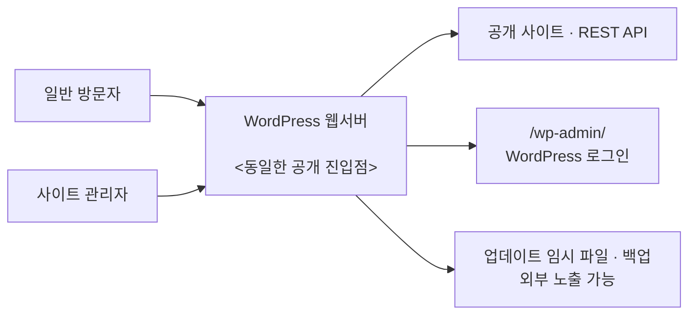
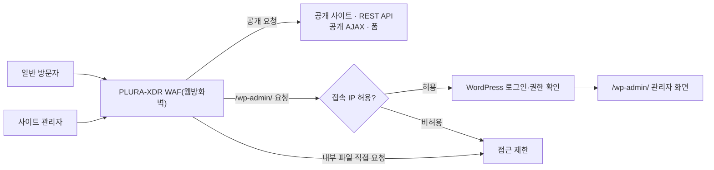

워드프레스(WordPress)는 홈페이지와 블로그, 쇼핑몰을 만들고 운영할 수 있는 콘텐츠 관리 시스템(CMS)입니다.  
테마로 디자인을 바꾸고, 플러그인으로 게시판·회원·예약·결제 같은 기능을 쉽게 추가할 수 있습니다.

문제는 워드프레스가 위험한 플랫폼이어서가 아니라,  
**운영이 편리한 만큼 공격자가 노릴 수 있는 기능도 계속 늘어난다**는 점입니다.

- 업데이트하지 않은 코어와 플러그인
- 외부에 열려 있는 관리자 기능과 REST API
- 웹에서 내려받을 수 있는 백업·설정 파일
- 업로드한 PHP 파일이 실행되는 서버 설정
- 공격을 당하고도 서버에서 무슨 일이 일어났는지 알기 어려운 로그 환경

워드프레스 사이트를 안전하게 운영하려면 기본 업데이트와 관리자 계정 보호가 먼저입니다.  
하지만 그것만으로 모든 공격을 막을 수 있는 것은 아닙니다.

**일반 방문자에게 필요하지 않은 접근은 줄이고, 정상 기능으로 들어오는 악성 요청은 탐지하며, 공격 이후 서버의 변화까지 확인하는 것.**  
이것이 PLURA-XDR이 워드프레스 보안에서 중요하게 보는 방향입니다.

---

## 1. 워드프레스는 왜 공격받기 쉬울까요?

워드프레스의 가장 큰 장점은 확장성입니다.  
그만큼 사이트마다 설치된 플러그인과 테마, 공개된 기능이 달라집니다.

예를 들어 쇼핑몰은 결제 연동이 필요하고, 예약 사이트는 예약 처리 기능이 필요하며, 회원 사이트는 로그인과 계정 관리 기능이 필요합니다.

모두 정상적인 기능입니다.  
하지만 플러그인의 권한 검증이 부족하거나 오래된 코드에 취약점이 남아 있다면 그 기능이 공격의 출발점이 될 수 있습니다.

왜 중요한가

- 공격자는 사이트의 화면만 보는 것이 아니라 공개된 API와 관리 기능도 탐색합니다.
- 백업·로그·임시 파일이 웹에서 제공되면 로그인하지 않고도 내부 정보에 접근할 수 있습니다.
- 정상 요청처럼 보이는 공격은 URL만 보고 차단하기 어렵습니다.

즉, 워드프레스 보안은  
**어떤 기능을 제공할 것인지뿐 아니라, 어떤 기능을 외부에 공개하지 말아야 하는지**까지 함께 설계해야 합니다.

---

## 2. 업데이트 임시 파일도 공격 경로가 될 수 있습니다

워드프레스 보안에서 가장 먼저 권장하는 것은 최신 업데이트입니다.

그런데 업데이트 과정에서 만들어진 임시 파일이 외부에 노출된다면,  
업데이트 작업 자체가 새로운 공격 경로가 될 수도 있습니다.

### WordPress Core 취약점 — CVE-2026-119977

이 취약점은 WordPress Core의 업데이트 과정에서 생성되는 설치 파일의 외부 접근 문제와 관련이 있습니다.

대표적인 경로는 다음과 같습니다.

`/wp-content/upgrade/`

이곳은 방문자에게 게시물이나 이미지를 제공하는 영역이 아니라 업데이트 작업을 위한 임시 영역입니다.

문제는 업데이트용 파일이 웹에서 직접 실행될 수 있을 때입니다.  
이 경로에 남아 있는 설치 스크립트를 외부에서 호출하면 **워드프레스 설정이 변경되거나 서버 명령 실행으로 이어지는 위험**이 발생할 수 있습니다.

왜 중요한가

- 설치 파일은 서버 내부의 업데이트 작업에 필요하지만, 일반 방문자에게 제공할 파일은 아닙니다.
- 공격자는 관리자 화면을 통하지 않고 임시 설치 스크립트를 직접 호출할 수 있습니다.
- 업데이트 작업이 끝난 뒤에도 임시 파일이 남아 있으면 불필요한 공격 표면이 됩니다.

따라서 **업데이트 기능은 유지하되, 임시 설치 디렉터리의 외부 HTTP 접근은 제한하는 것**이 중요합니다.

---

## 3. 정상적인 REST API에서도 공격이 발생합니다

반대로, 공격이 발생했다고 해서 해당 경로를 모두 차단할 수 없는 경우도 있습니다.

워드프레스의 REST API는 게시물 조회와 플러그인 연동, 회원 및 서비스 기능에 실제로 사용되기 때문입니다.

### Project Manager 플러그인 — CVE-2026-116512

이 사례는 weDevs Project Manager 플러그인이 제공하는 정상적인 프로젝트 관리 API에서 발생한 입력값 처리 취약점입니다.

프로젝트 정보를 변경하는 API는 정상적인 업무에 필요한 기능입니다.  
하지만 외부에서 전달한 입력값을 안전하게 처리하지 않으면, **일반 프로젝트 수정 요청이 서버 명령 실행에 악용될 수 있습니다.**

이 취약점은 API를 사용한다는 사실 자체보다  
**플러그인이 입력값을 검증하고 처리하는 방식**에서 발생합니다.

따라서 API 경로를 알고 있다는 사실만으로 공격 여부를 판단하기 어렵습니다. 요청 내용과 실제 처리 동작을 함께 살펴야 합니다.

또한 정상적인 REST API 전체를 막는 것은 답이 아닙니다.  
그렇게 하면 공격뿐 아니라 워드프레스와 플러그인의 정상 기능도 중단될 수 있습니다.

실무 포인트

- URL뿐 아니라 HTTP 메서드와 요청 본문을 함께 분석합니다.
- 정상 요청과 공격 요청의 차이를 확인합니다.
- 응답 상태 코드만으로 침해 성공 여부를 판단하지 않습니다.

**정상적인 기능은 유지하면서 그 안에 숨은 공격을 구분하는 것**이 필요한 이유입니다.

---

## 4. PLURA-XDR은 불필요한 접근을 어떻게 줄이려는가?

두 사례의 대응은 같을 수 없습니다.

업데이트 임시 파일처럼 **방문자가 접근할 이유가 없는 곳은 닫고**,  
정상적인 API처럼 **사이트 운영에 필요한 곳은 유지하면서 공격 요청을 탐지**해야 합니다.

PLURA-XDR은 이 기준에 따라 워드프레스 코어와 주요 플러그인의 접근제어 범위를 정리하고 있습니다.

### 4-1. 임시 설치 파일과 백업 저장소

`/wp-content/upgrade/`와 `/wp-content/upgrade-temp-backup/`은 업데이트 및 복구 작업에 사용되는 내부 저장 영역입니다.

`/wp-content/updraft/` 같은 백업 저장소, `/wp-content/wflogs/` 같은 보안 제품 내부 로그 저장소도 일반 방문자에게 공개할 필요가 없는 대표적인 사례입니다.

왜 중요한가

- 백업에는 데이터베이스와 사이트 설정이 포함될 수 있습니다.
- 로그에는 서버 정보와 민감한 요청 기록이 남을 수 있습니다.
- 내부 설치 파일을 웹에서 직접 호출할 이유는 없습니다.

**파일을 삭제하는 것이 아니라, 서버 내부에서 사용하는 기능은 살리고 외부 직접 접근을 제한하는 것**이 목적입니다.

### 4-2. 업로드 파일과 내부 PHP 코드

`/wp-content/uploads/`에는 게시물 이미지와 첨부파일이 들어갑니다.  
이 경로를 모두 차단하면 방문자는 사진을 보거나 파일을 내려받을 수 없습니다.

따라서 이미지·문서는 제공하되, 업로드 영역의 PHP 같은 서버 실행형 파일은 직접 실행되지 않도록 제한하는 방식이 적절합니다.

`/wp-includes/`에도 공개 JavaScript·CSS와 내부 PHP 코드가 함께 존재합니다.  
모든 요청을 막는 대신 방문자에게 필요한 정적 자산과 내부 코드의 직접 실행을 구분해야 합니다.

### 4-3. 관리자 화면과 공개 기능

일반 방문자가 워드프레스 관리자 설정 화면을 사용할 이유는 없습니다.  
그러나 `/wp-admin/`을 통째로 차단하는 것도 정답은 아닙니다.

- `/wp-admin/admin-ajax.php`는 비로그인 방문자의 정상 AJAX 기능에 사용될 수 있습니다.
- `/wp-admin/admin-post.php`는 공개 폼 제출에 사용될 수 있습니다.
- 관리자 경로의 CSS·JavaScript는 로그인 화면 등에 필요할 수 있습니다.

관리 화면에 대한 익명 접근은 줄이되, 정상적인 로그인 흐름과 공개 기능은 보존해야 합니다.  
실제 인증 여부를 확인하지 않고 경로 문자열만으로 일괄 차단해서는 안 되는 이유입니다.

**PLURA-XDR이 검토하는 것은 워드프레스의 모든 경로를 막는 정책이 아닙니다.**  
외부 공개가 불필요한 내부 영역을 우선 보호하고 정상 기능에 대한 영향을 구분하는 접근제어입니다.

PLURA-XDR은 이처럼 **정상 기능을 제공하는 경로는 유지하고, 외부에 공개할 이유가 없는 내부 영역의 접근은 줄이는 방향**으로 워드프레스 보호 범위를 강화해 나갈 계획입니다.

---

## 5. 공격을 탐지한 뒤에는 서버에서 무슨 일이 일어났는지 봐야 합니다

웹방화벽에 공격 로그가 남으면 운영자는 보통 이렇게 생각합니다.

"공격이 들어왔구나."

하지만 여기서 한 가지 질문이 더 필요합니다.

**"그 요청 이후 서버에서는 실제로 무엇이 일어났는가?"**

공격 요청 하나만으로는 침해 여부를 판단하기 어렵습니다.

예를 들어 악성 요청 이후에 다음과 같은 변화가 이어질 수 있습니다.

- 웹서버 프로세스의 비정상적인 명령 실행
- PHP 파일이나 설정 파일의 생성·수정
- 새로운 관리자 계정이나 권한 변경
- 외부 서버로의 의심스러운 통신
- 같은 서버 또는 다른 시스템으로 이어지는 추가 접근

물론 모든 웹 공격이 이런 결과를 만드는 것은 아닙니다.  
차단되었거나 취약점이 없는 요청이라면 서버에 별다른 영향이 없을 수도 있습니다.

중요한 것은 공격 문자열을 발견했다는 이유만으로 피해를 단정하지 않고,  
반대로 응답이 오류였다는 이유만으로 안전하다고 판단하지 않는 것입니다.

**웹에서 시작된 요청과 서버에 남은 실행·파일·계정 기록을 연결해야**  
단순한 시도인지, 실제 침해로 이어진 사건인지 구분할 수 있습니다.

---

## 6. PLURA-XDR은 웹과 호스트의 기록을 하나의 흐름으로 봅니다

워드프레스 운영자가 모든 공격 흔적을 각 시스템에서 따로 찾아보는 것은 쉽지 않습니다.

웹방화벽은 HTTP 요청을 보고, 서버에는 파일과 프로세스 기록이 남고, 계정 사용 내역은 또 다른 로그에 남기 때문입니다.

PLURA-XDR은 **웹방화벽(WAF), 호스트 보안(EDR), 통합 로그 분석과 대응 기능**을 연결하는 구조에 초점을 둡니다.

### 6-1. Request Body / Response Body 기반 분석

공격자가 보낸 데이터는 URL에만 남지 않습니다.

정상적인 게시물 수정이나 플러그인 요청처럼 보이더라도, 요청 본문(Request Body)에 악의적인 입력값이 포함될 수 있습니다.

PLURA-XDR의 웹방화벽은 요청 경로·메서드·본문을 함께 살펴 공격 패턴을 분석합니다.  
응답 본문(Response Body)은 처리 결과나 정보 노출 징후를 파악할 때 함께 볼 수 있는 자료입니다.

### 6-2. 호스트 로그와 상관분석

웹 요청을 확인한 다음에는 해당 시간대 서버 로그를 살펴봐야 합니다.

- 웹 요청과 서버 프로세스 실행 시점이 이어지는가?
- 파일 생성·변경이 요청 직후 발생했는가?
- 계정 로그인과 권한 변경이 같은 공격 흐름에 포함되는가?

PLURA-XDR은 웹 로그와 호스트 로그의 관계를 분석해 사건을 한 흐름으로 파악하는 데 초점을 둡니다.

### 6-3. 대응과 증거 확보

실제 침해가 의심된다면 중요한 것은 알림을 많이 만드는 것이 아닙니다.

영향을 받은 서버와 계정을 확인하고, 추가 행위를 제한하며, 원본 로그와 변경 기록을 보존해야 합니다.  
이때 탐지·조사·대응·포렌식 증거를 연결하는 체계가 필요합니다.

즉, PLURA-XDR의 역할은  
**웹 공격을 발견하는 데서 끝나지 않고, 서버에서 일어난 결과를 근거로 대응까지 이어지게 하는 것**입니다.

---

#### 보안 조치가 부족한 워드프레스 환경의 예시

#### PLURA-XDR과 접근제어를 결합한 대응 방향

---

## 7. 웹사이트 관리자가 해야 할 일 3가지

PLURA-XDR을 활용하더라도 워드프레스 자체의 기본 보안을 생략할 수는 없습니다.

웹사이트 관리자가 우선 챙길 일은 다음 세 가지입니다.

| 관리자가 할 일 | 실무 포인트 |
| --- | --- |
| **1. 업데이트와 관리자 계정 보호** | WordPress 코어·테마·플러그인·PHP를 최신 상태로 유지하고, 사용하지 않는 플러그인과 불필요한 관리자 권한을 정리합니다. 관리자 계정에는 강력한 인증과 2FA/MFA를 적용합니다. |
| **2. 공개 파일과 백업 보호** | 업로드 영역에서 PHP 실행을 제한하고, 설정·백업·로그의 외부 직접 접근을 막습니다. 백업은 별도 저장소에 보관하고 정기적으로 복원 테스트를 합니다. |
| **3. 공격 흔적 확인과 대응 준비** | 로그인·HTTP 요청과 응답·서버 프로세스·파일 변경 기록을 살펴봅니다. 침해가 의심되면 비정상 계정·파일·프로세스를 조사하고 원본 로그를 보존합니다. |

특히 업데이트나 백업은 한 번 설정했다고 끝나지 않습니다.  
운영 중 플러그인이 추가되고 기능이 달라지면 보안 점검도 계속 필요합니다.

**기본 설정 + 웹 공격 탐지 + 호스트 행위 확인**을 함께 운영해야 하는 이유입니다.

---

## 마치며

워드프레스는 위험한 플랫폼이라기보다  
**편리하고 널리 쓰이기 때문에 공격자에게도 익숙한 플랫폼**입니다.

그래서 중요한 것은 모든 기능을 막는 것이 아닙니다.

외부에 공개할 필요가 없는 내부 영역은 보호하고,  
실제 이용자가 사용하는 기능에서는 악성 요청을 구분하며,  
공격이 발생했다면 서버에서 어떤 결과로 이어졌는지 확인해야 합니다.

PLURA-XDR은 워드프레스 환경에서 **불필요한 외부 접근을 줄이고, 정상 기능을 악용하는 공격을 분석하며, 웹과 호스트의 기록을 연결하는 대응**을 강화해 나가겠습니다.

워드프레스 사이트를 운영하고 있다면  
오늘 바로 업데이트와 관리자 인증을 점검하고,  
그다음에는 **공격 흔적을 얼마나 빨리 알아차리고 실제 피해를 확인할 수 있는지**까지 살펴보시기 바랍니다.

---

### 📖 함께 읽기

- [워드프레스로 만든 사이트 필수 보안 TOP 10](https://blog.plura.io/ko/tech/wordpress_security_top10-1/)
- [Hardening WordPress — WordPress Developer Resources](https://developer.wordpress.org/advanced-administration/security/hardening/)
- [WordPress REST API Handbook](https://developer.wordpress.org/rest-api/)
- [WordPress AJAX — Plugin Handbook](https://developer.wordpress.org/plugins/javascript/ajax/)
- [CVE-2026-119977 — 공개 보안 권고](https://github.com/advisories/GHSA-p6jj-qrp3-7m4g)
- [CVE-2026-116512 — 공개 취약점 기록](https://www.cve.org/CVERecord?id=CVE-2026-116512)
