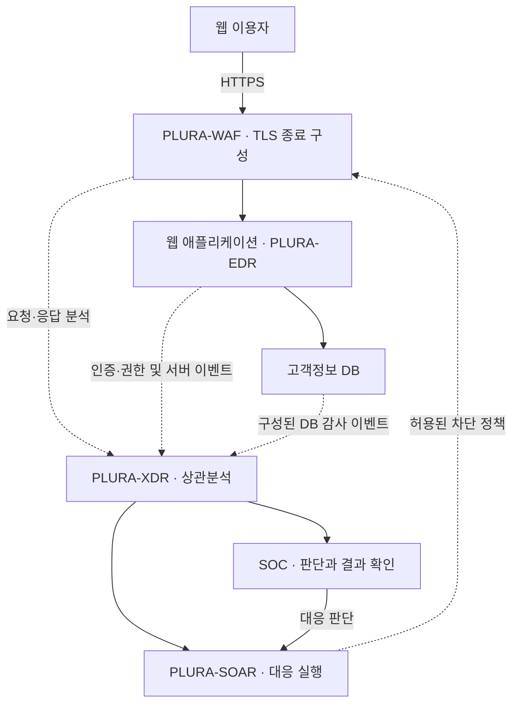

하나저축은행의 **모바일웹 고객확인 재이행 시스템**에서 고객 **552명의 개인(신용)정보가 유출된 정황**이 확인됐습니다. 공개된 유출 항목은 이름·주민등록번호·전화번호·주소·직장정보 등을 포함한 **19개 항목**이며, 고객마다 해당 항목은 다를 수 있습니다. 추가 피해 고객이 있는지는 조사 중입니다. [1][yna] [2][anewsa]

사건을 이해할 때 먼저 구분해야 할 것이 있습니다. **2026년 11월 16일은 은행이 유출 정황을 확인했다고 밝힌 날입니다.** 실제 최초 침입 시점, 악용된 취약점과 구체적인 침입 경로는 공개되지 않았습니다. [3][dailysecu]

고객정보를 처리하는 웹 기능이 침해됐다면, 보안팀은 다음 질문에 답할 수 있어야 합니다.

> **누가, 누구의 정보를 요청했고, 어떤 권한으로 처리됐으며, 실제로 무엇이 외부에 반환됐는가?**

이 질문에 답하려면 웹 요청·응답과 인증·권한 판단, 서버 행위를 연결하는 가시성이 필요합니다.

<!--more-->

> **분석 기준: 2026-11-26 공개 자료.** 사건 사실은 은행 공지를 인용한 보도로 확인했습니다. 아래의 공격 유형과 탐지 예시는 원인 규명을 위한 일반적인 분석·대응 제안이며, 하나저축은행에서 확인된 공격 기법이나 실제 운영 구성으로 제시하는 내용이 아닙니다.

---

## 🧾 1. 어떤 시스템에서 어떤 정보가 유출됐나

이번 사고의 대상은 **하나저축은행**입니다. 하나은행의 별도 침해사고와 구분해야 합니다.

고객확인 재이행은 기존 고객의 신원과 관련 정보를 다시 확인·갱신하는 업무입니다. 공개된 피해 목록에는 고객의 신원뿐 아니라 연락처, 거주지, 직장 관련 정보가 함께 포함돼 있습니다. [3][dailysecu]

| No. | 구분 | 공개된 유출 항목 |
|---:|---|---|
| 1 | 고객 식별 | 고객번호, 고객명, 영문명, 생년월일, 성별, 주민등록번호 |
| 2 | 연락처 | 전화번호, 자택전화번호, 이메일 |
| 3 | 주소 | 자택우편번호, 자택주소, 직장우편번호, 직장주소 |
| 4 | 국적 | 국적코드, 국적명 |
| 5 | 직업·상품 | 직업업종코드, 직업업종명, 직업직장명, 상품코드 |

위 목록은 공개된 19개 항목을 묶은 것입니다. **552명 모두에게 19개 항목이 전부 유출됐다는 의미는 아닙니다.** [1][yna] [2][anewsa]

이름에 연락처·주소·직장정보가 결합되면 피해자를 잘 아는 것처럼 꾸민 사칭 연락에 악용될 수 있습니다. 은행 역시 명의도용·보이스피싱·파밍 등 2차 피해 가능성을 안내했습니다. 따라서 피해의 무게는 인원수와 함께 **유출 정보의 성격과 조합**으로 평가해야 합니다. [3][dailysecu]

---

## 📅 2. 침해 인지와 대응 타임라인

| No. | 시점 | 공개 자료로 확인되는 내용 |
|---:|---|---|
| 1 | 2026-11-16 | 모바일웹 고객확인 재이행 시스템에 대한 외부 불법 침입으로 고객정보가 유출된 정황을 확인했다고 은행이 설명 |
| 2 | 유출 인지 후, 정확한 시각 미공개 | 외부 IP 접근 차단, 추가 보안 조치, 24시간 모니터링 강화 |
| 3 | 2026-11-19 | 홈페이지 안내·사과문 게시, 피해 고객에게 휴대전화 또는 우편으로 개별 통지 |
| 4 | 2026-11-24~25 보도 시점 | 추가 유출 고객 여부를 조사 중이며 사고 관련 피해구제 지원 절차를 마련 중이라고 설명 |

유출 정황 확인과 개별 통지, 사후 차단 조치는 은행 발표를 인용한 보도에서 확인됩니다. [1][yna] [2][anewsa]

다만 이 일정만으로 **공격이 11월 16일 시작됐다거나, 3일간 공격이 지속됐다거나, 탐지에 3일이 걸렸다고 계산할 수는 없습니다.** 최초 공격 시각과 최초 경보 시각이 공개되지 않았기 때문입니다.

또한 **24시간 모니터링 강화는 사고 인지 이후의 조치**입니다. 이를 사고 당시 실시간 탐지가 작동했다는 근거로 사용할 수는 없습니다.

---

## 🔍 3. 구체적인 침투 경로는 어디까지 밝혀졌나

현재 공개 자료에서 확인되는 범위는 **모바일웹 고객확인 재이행 시스템에 외부의 불법적인 침입이 있었고, 고객정보 유출 정황이 확인됐다**는 것입니다. 악용된 취약점, 최초 침입 시점, 내부 시스템으로의 추가 침해 여부는 공개되지 않았습니다. [3][dailysecu]

따라서 다음 사항은 추가 증거가 필요합니다.

| No. | 조사 단계 | 밝혀야 할 내용 |
|---:|---|---|
| 1 | 최초 접근 | 공격받은 URL·API, 최초 요청 시각, 접근 경로 |
| 2 | 인증·권한 | 로그인 필요 여부, 사용 계정·세션, 조회 권한의 검증 방식과 처리 결과 |
| 3 | 정보 조회 | 실제 조회 대상, 애플리케이션 처리 결과, 연관된 DB 접근 |
| 4 | 서버 침해 | 웹셸·명령 실행·파일 변경·권한 상승·다른 서버 접근 여부 |
| 5 | 정보 반출 | 웹 응답, 파일 다운로드, 별도 외부 전송 등 실제 유출 방식 |
| 6 | 최초 탐지 | 자체 관제 경보, 외부 기관 통보, 고객 신고 등 최초 인지 계기 |

**개인정보 유출이 확인됐다고 해서 웹 서버 장악이나 웹셸 설치까지 확인된 것은 아닙니다.** 일반적인 웹/API 환경에서는 서버의 조회 기능이 잘못된 권한으로 실행돼 응답을 통해 정보가 노출되는 경로도 존재합니다.

예를 들어, 다음은 **객체별 접근 권한 검증 실패를 설명하는 가상 사례**입니다.

1. 고객 A가 자신의 계정으로 정상 로그인합니다.
2. A의 세션에서 고객 B의 정보를 요청합니다.
3. 서버가 A에게 B의 정보를 조회할 권한이 있는지 검증하지 않습니다.
4. B의 개인정보가 응답으로 반환됩니다.

OWASP는 이러한 객체 단위 권한 검증 문제를 **BOLA(Broken Object Level Authorization)**로 설명합니다. API에 접근할 수 있는 권한과 특정 고객의 정보를 볼 수 있는 권한을 각각 확인해야 합니다. [5][bola]

이 경우 별도의 악성 파일이나 외부 전송 프로그램 없이도 정보가 유출될 수 있습니다. SQL 인젝션이나 서버 실행 권한 침해 여부는 요청 입력값과 DB 처리, 프로세스·파일 실행 흔적을 대조해 검증해야 합니다. [6][sqli] [7][mitre]

특정 CVE, AI 사용, 다른 금융사 사고와 동일한 공격자라는 결론 역시 현재 확인한 공개 자료로 뒷받침되지 않습니다.

---

## 🕵️ 4. 최초 탐지 방식과 실제 탐지 역량을 어떻게 평가해야 하나

은행의 발표를 인용한 자료에는 **어떤 장비나 어떤 분석으로 최초 침해를 발견했는지**가 제시돼 있지 않습니다. 외부 IP를 차단했다는 사실만으로 WAF가 최초 탐지했다거나 자동 차단했다고 해석할 수도 없습니다. [1][yna] [3][dailysecu]

탐지 역량을 평가하려면 다음 시점을 나누어 확인해야 합니다.

| No. | 확인 시점 | 평가할 내용 |
|---:|---|---|
| 1 | 최초 악성 요청 | 공격이 언제 시작됐는가 |
| 2 | 최초 무단 정보 반환·반출 | 실제 정보 노출이 언제 발생했는가 |
| 3 | 최초 관련 경보 | 보안 시스템이 언제 이상 징후를 알렸는가 |
| 4 | 담당자의 사고 인지 | 언제 실제 침해로 판단했는가 |
| 5 | 차단 적용·효과 확인 | 언제 접근을 제한했고, 같은 접근이 실제로 거부됐는가 |

이 구분이 있어야 **탐지 지연, 판단 지연, 대응 지연**을 각각 평가할 수 있습니다. 경보가 발생했어도 실제 유출과 연결하지 못했다면 판단 과정의 문제를, 침해를 확인하고도 조치가 늦었다면 대응 과정의 문제를 살펴봐야 합니다.

운영 설계에서는 다음과 같은 관측을 연결할 수 있습니다. 아래는 이번 사고에서 사용됐다는 탐지 규칙이 아니라 **고객정보 처리 서비스에 적용할 탐지 예시**입니다.

| No. | 탐지 예시 | 함께 확인할 근거 |
|---:|---|---|
| 1 | 한 세션에서 여러 고객의 정보를 반복 조회 | 요청한 고객 객체, 호출자의 업무 권한, 실제 반환 대상 |
| 2 | 권한 거부 후 다른 기능에서 같은 대상 조회 성공 | 앞선 거부 사유, 후속 처리 결과, 응답에 포함된 데이터 |
| 3 | 계정의 평소 업무 범위를 벗어난 정보 조회 | 로그인 맥락, 사용 기능, 대상 고객 수, 정상 업무 내역 |
| 4 | 웹 요청 직후 서버에서 비정상 실행 발생 | 웹 런타임의 자식 프로세스, 파일 생성·변경, 실행 계정 |
| 5 | IP 차단 후 다른 접속에서 유사 행위 지속 | 계정·세션·요청 대상·행위의 연관성과 정상 이용 여부 |

이러한 분석은 웹/API의 권한 검증, 서버 행위 탐지, 여러 출처의 사건 상관분석을 결합하는 설계입니다. OWASP는 객체별 권한 검증을, MITRE는 웹 경로의 파일 변화와 서버 프로세스 실행의 연계를, NIST는 지속적인 로그 분석과 여러 출처의 상관분석을 제시합니다. [5][bola] [7][mitre] [8][nist]

조회 횟수만으로 공격을 판단해서는 안 됩니다. 정상적인 직원 업무가 여러 고객을 조회할 수도 있고, 권한 없는 한 건의 조회만으로도 개인정보가 노출될 수 있기 때문입니다. **호출량과 함께 업무 권한·조회 대상·반환 결과를 확인하는 기준**이 필요합니다.

---

## 🧬 5. 웹 요청·응답과 운영체제 감사 로그를 연결해야 한다

### 웹 요청: 무엇을 하려고 했는가

요청의 URL과 메서드, 헤더·본문에서 대상 기능과 입력값을 확인합니다. 이때 인증된 주체와 세션, 요청 대상 고객 객체를 연결해야 합니다. 접속 IP 하나만으로 사람이나 공격자를 확정하기는 어렵습니다.

### 웹 응답: 실제로 무엇이 반환됐는가

HTTP `200`과 응답 크기만으로 개인정보 유출을 확정할 수는 없습니다. 응답에 어떤 항목이 포함됐고, 누구의 정보가 몇 건 반환됐는지 확인해야 합니다. 권한 판단과 연결하면 **접근 시도와 실제 무단 반환을 구분**하는 데 도움이 됩니다.

PLURA-WAF는 지원 구성에서 요청·응답의 헤더와 본문을 분석하고 데이터 노출 징후를 확인하는 기능을 설명하고 있습니다. 실제 확인 범위는 수집 지점과 설정에 따라 달라집니다. [11][plura-waf]

### 애플리케이션: 그 정보를 볼 권한이 있었는가

업무 권한과 대리 조회 관계는 애플리케이션의 판단 정보가 필요합니다. 웹 데이터에 인증 주체, 대상 객체, 허용·거부 결과를 연결하고, 필요한 경우 DB 조회 범위도 대조해야 합니다.

OWASP 역시 애플리케이션이 사용자 역할·권한·처리 결과의 맥락을 가지고 있음을 설명합니다. 요청 식별자와 동기화된 시각을 활용하면 관련 이벤트를 더 정확히 연결할 수 있습니다. [9][logging]

### 운영체제: 서버에서 어떤 실행과 변경이 있었는가

서버 침해 여부는 웹 런타임의 비정상 자식 프로세스, 웹 경로의 파일 생성·변경, 실행 계정, 외부 연결 등을 확인해야 합니다. MITRE의 웹셸 탐지 전략도 파일 변화와 웹 서버의 비정상 프로세스 실행을 함께 분석합니다. [7][mitre]

**PLURA-XDR에서 웹셸 대응을 구성하려면 웹 서버에 PLURA-EDR을 설치하고, 필요한 운영체제 감사 정책과 이벤트 수집을 활성화해야 합니다.** PLURA-EDR은 이러한 감사 로그와 시스템 이벤트를 기반으로 프로세스·파일·계정 행위를 분석합니다. 감사 정책이 꺼져 있거나 수집되지 않은 이벤트는 분석 근거로 사용할 수 없습니다. [12][plura-edr]

웹 요청과 서버 이벤트가 비슷한 시각에 나타났다는 이유만으로 인과관계가 확정되는 것은 아닙니다. 요청 식별자, 처리 프로세스, 대상 파일 등 연결 근거를 확인하고 근거가 부족한 관계는 추정으로 남겨야 합니다. [13][plura-siem]

---

## 🔐 6. HTTPS 가시성과 차단 시점을 함께 설계해야 한다

### 암호화된 패킷만으로 개인정보 내용을 확인할 수는 없다

TLS는 애플리케이션 데이터를 암호화해 전송합니다. 따라서 HTTPS 패킷을 그대로 미러링한 데이터만으로 HTTP 요청·응답 본문을 읽을 수는 없습니다. 인가된 TLS 종료·복호화 지점이나 애플리케이션에서 분석 가능한 데이터를 확보해야 합니다. [10][tls]

패킷의 크기·방향·시간 정보는 이상 징후를 살피는 데 도움이 될 수 있습니다. 그러나 **어떤 고객의 어떤 정보가 반환됐는지 확인하는 근거**는 해당 내용을 관측할 수 있는 지점에서 확보해야 합니다. 애플리케이션이 본문을 별도로 암호화한다면 그 처리 지점도 고려해야 합니다.

웹 요청·응답 전수 분석을 목표로 할 때는 다음 범위를 먼저 확인해야 합니다.

- 보호 대상 도메인·URL·API가 분석 경로를 통과하는가.
- 원본 서버로 직접 접근하는 우회 경로가 통제돼 있는가.
- 본문 크기 제한, 업로드 예외, 압축·인코딩 처리로 검사에서 빠지는 부분이 있는가.
- 파싱 실패와 수집 누락을 운영자가 식별할 수 있는가.

### 탐지 후 차단과 최초 유출 방지를 구분해야 한다

미러링 또는 대역외 분석에서 이미 전송된 응답을 확인했다면, 그 응답에 포함된 정보를 나중의 IP 차단으로 회수할 수는 없습니다.

최초 무단 반환을 방지하려면 **애플리케이션이 반환 전에 권한을 검증**해야 합니다. 보안 장비에 의한 차단은 해당 트래픽의 경로, 검사 대상, 동기 차단 여부를 확인하고 실제 적용 결과를 검증해야 합니다. 탐지 이후의 추가 접근 제한과 최초 응답 차단은 운영 성과에서도 구분해야 합니다. [5][bola] [11][plura-waf]

### 분석 데이터에도 보호 기준이 필요하다

비밀번호·인증 토큰·주민등록번호 등의 원문 저장은 필요성을 제한하고, 제외·마스킹·가명화 등의 방식을 적용해야 합니다. 대상 식별값, 반환 건수, 개인정보 포함 여부, 권한 판단 결과를 활용하면 필요한 연결 관계를 유지하면서 불필요한 원문 저장을 줄일 수 있습니다. 저장하는 자료에는 접근 통제, 보관 기간, 보호 조치와 열람 기록도 적용해야 합니다. [9][logging]

---

## 🛡️ 7. PLURA-XDR 관점의 대응 구성

다음은 공개된 제품 기능을 바탕으로 한 **대응 설계 예시**입니다. PLURA 제품이 하나저축은행에 설치돼 있었거나 이번 사고를 탐지했다는 의미는 아닙니다.

| No. | 구성 | 이 유형의 사고에서 담당할 역할 |
|---:|---|---|
| 1 | **PLURA-WAF** | 지원 구성에서 웹 요청·응답을 분석하고, 비정상 접근·로그인 공격·데이터 노출 징후를 정책에 따라 탐지·차단 |
| 2 | **PLURA-EDR** | 웹 서버의 감사 로그와 시스템 이벤트로 프로세스·파일·계정 및 후속 실행 흔적 분석 |
| 3 | **PLURA-SIEM / XDR** | 웹·호스트·계정 데이터를 연결하고, 별도로 확보한 업무 권한·조회 결과를 함께 검토 |
| 4 | **PLURA-SOAR** | 사전에 정한 조건과 권한에 따라 허용된 대응을 실행하고, 성공·실패·미완료 결과 확인 |
| 5 | **PLURA-Forensic** | 지원 호스트의 상태·변경 흔적을 조사해 침해 범위와 잔존 접근 가능성 확인 지원 |
| 6 | **SOC 운영** | 경보의 업무 맥락 확인, 사고 판단, 차단 결과 확인, 후속 대응 관리 |

제품별 역할과 제공 범위는 PLURA 공식 WAF·EDR·SIEM·SOAR·Forensic 및 XDR 설명을 기준으로 정리했습니다. [11][plura-waf] [12][plura-edr] [13][plura-siem] [14][plura-soar] [15][plura-forensic] [16][plura-xdr]

### 권장 연결 구조 예시

WAF를 **Reverse Proxy**로 배치해 보호 대상 트래픽이 통과하도록 구성하는 예입니다.

인증·권한 판단과 DB 감사 정보는 별도의 로그 생성·연동 설계가 필요합니다. 세션 폐기나 계정 제한도 해당 애플리케이션의 기능·API와 연동 권한을 확인해 구현해야 합니다.

객체별 권한 검증과 취약점 수정은 애플리케이션에서 수행하고, WAF·EDR·XDR은 공격 관측과 차단, 후속 침해 확인을 연결하는 방식으로 운영해야 합니다. 특정 IP를 차단한 뒤에도 같은 계정·다른 세션·다른 접근 경로에서 문제가 지속되는지 확인해야 합니다.

---

## ✅ 8. 금융사가 바로 확인해야 할 점검 항목

다음은 앞선 분석을 운영 점검으로 옮긴 항목입니다. 권한과 탐지 검증에는 시험계정과 테스트 데이터를 사용합니다.

| No. | 점검 항목 | 확인 기준 |
|---:|---|---|
| 1 | 고객정보 처리 기능·권한 | 기능·API의 접근 경로를 파악하고, 고객별·역할별 허용 범위를 서버가 검증하는지 확인 |
| 2 | 요청·응답 가시성 | TLS 처리 지점, 본문 분석 범위, 예외·절단·수집 누락 확인 |
| 3 | 서버 행위 가시성 | 웹 서버 EDR 설치, 감사 정책 활성화, 필요한 이벤트의 실제 생성·수집 확인 |
| 4 | 탐지부터 차단 효과까지 | 시험 이벤트의 경보·담당자 판단·정책 적용과 재접근 거부까지 확인 |
| 5 | 원인 수정·재검증 | 확인된 취약점·권한 결함 수정, 잔존 접근 제거 후 악용 재현 차단과 정상 기능 동작 확인 |

핵심은 **현재 발생하는 무단 접근과 정보 반환을 발견하고, 추가 피해를 제한하는 과정이 실제로 작동하는지**를 확인하는 것입니다. NIST의 침해대응 지침도 지속적인 관측, 관련 이벤트 분석, 담당자 전달과 대응을 연결하도록 권고합니다. [8][nist]

---

## 마무리

하나저축은행 사건에서 공개된 침해 지점은 **고객정보를 처리하는 모바일웹 시스템**입니다. 구체적인 취약점과 최초 탐지 방식이 공개되기 전까지 특정 공격 기법이나 탐지 실패 원인을 확정할 수는 없습니다.

금융사의 대응 체계는 다음 질문을 실제 관측 데이터로 설명할 수 있어야 합니다.

**누가 어떤 정보를 요청했는가. 그 요청은 권한에 맞았는가. 무엇이 반환됐는가. 서버에서는 어떤 일이 있었는가. 그리고 추가 접근은 실제로 차단됐는가.**

웹 요청·응답, 인증·권한 판단, 운영체제 감사 로그를 연결하면 이 질문에 답할 근거가 생깁니다. 그 근거를 탐지와 대응으로 이어가는 것이 PLURA-XDR 관점에서 제안하는 방향입니다.

> **가시성은 AI의 눈입니다.**
> AI가 공격의 맥락을 설명하려면 요청·응답과 실제 행위를 확인할 수 있는 데이터가 먼저 확보돼야 합니다.

---

## 📖 함께 읽기

- [국립외교원 해킹 사건 분석 — 침투 경로와 탐지·대응의 쟁점][related-knda]
- [PLURA-WAF — 웹 요청·응답 분석과 웹 공격 대응][plura-waf]
- [PLURA-EDR — 운영체제 감사 로그와 서버 행위 분석][plura-edr]
- [PLURA-XDR — 웹·호스트·계정 데이터의 통합 분석과 대응][plura-xdr]

## 📚 참고 자료

### 사건 관련 자료

1. [연합뉴스, 「하나저축은행도 뚫렸다…고객 552명 개인정보 유출」, 2026-11-24][yna]
2. [아시아뉴스통신, 「하나저축은행 552명 개인정보 유출…이름·주민번호 등」, 2026-11-25][anewsa]
3. [데일리시큐, 「하나저축은행 해킹…고객 552명 주민등록번호 등 개인신용정보 유출 확인」, 2026-11-25][dailysecu]
4. [하나저축은행, 「개인(신용)정보 유출 관련 안내 및 사과문」, 2026-11-19][hana-notice] — 공식 공지 주소. 이 글의 사건 사실은 해당 공지를 인용한 위 보도로 대조했습니다.

### 기술·제품 자료

5. [OWASP API Security Top 10 — API1:2023 Broken Object Level Authorization][bola]
6. [OWASP — SQL Injection Prevention Cheat Sheet][sqli]
7. [MITRE ATT&CK — Web Shell Detection via Server Behavior and File Execution Chains, DET0394][mitre]
8. [NIST SP 800-61 Rev. 3 — Incident Response Recommendations and Considerations for Cybersecurity Risk Management][nist]
9. [OWASP — Logging Cheat Sheet][logging]
10. [IETF RFC 8446 — TLS 1.3의 애플리케이션 데이터 보호 원리][tls]
11. [PLURA-WAF 공식 제품 설명][plura-waf]
12. [PLURA-EDR 공식 제품 설명][plura-edr]
13. [PLURA-SIEM 공식 제품 설명][plura-siem]
14. [PLURA-SOAR 공식 제품 설명][plura-soar]
15. [PLURA-Forensic 공식 제품 설명][plura-forensic]
16. [PLURA-XDR 공식 제품 설명][plura-xdr]

[yna]: https://www.yna.co.kr/amp/view/AKR20261124174000002
[anewsa]: https://m.anewsa.com/article_sub3.php?number=3221252
[dailysecu]: https://www.dailysecu.com/news/articleView.html?idxno=209707
[hana-notice]: https://www.hanasavings.com/CUS/CUS010101?boardId=3&id=859
[bola]: https://api-security.owasp.org/editions/2023/en/0xa1-broken-object-level-authorization/
[sqli]: https://cheatsheetseries.owasp.org/cheatsheets/SQL_Injection_Prevention_Cheat_Sheet.html
[mitre]: https://attack.mitre.org/detectionstrategies/DET0394/
[nist]: https://csrc.nist.gov/pubs/sp/800/61/r3/final
[logging]: https://cheatsheetseries.owasp.org/cheatsheets/Logging_Cheat_Sheet.html
[tls]: https://www.rfc-editor.org/rfc/rfc8446
[plura-waf]: https://www.plura.io/ko/platform_waf.html
[plura-edr]: https://www.plura.io/ko/platform_edr.html
[plura-siem]: https://www.plura.io/ko/platform_siem.html
[plura-soar]: https://www.plura.io/ko/platform_soar.html
[plura-forensic]: https://www.plura.io/ko/platform_forensic.html
[plura-xdr]: https://www.plura.io/ko/platform_xdr.html
[related-knda]: https://blog.plura.io/ko/threats/case-knda-hack-2026/
